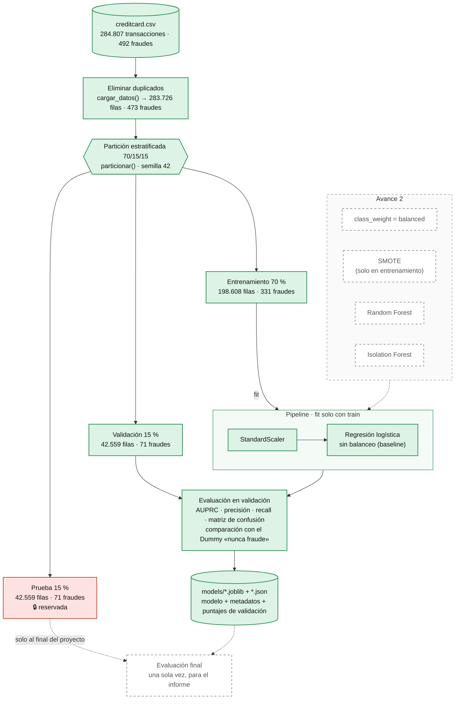
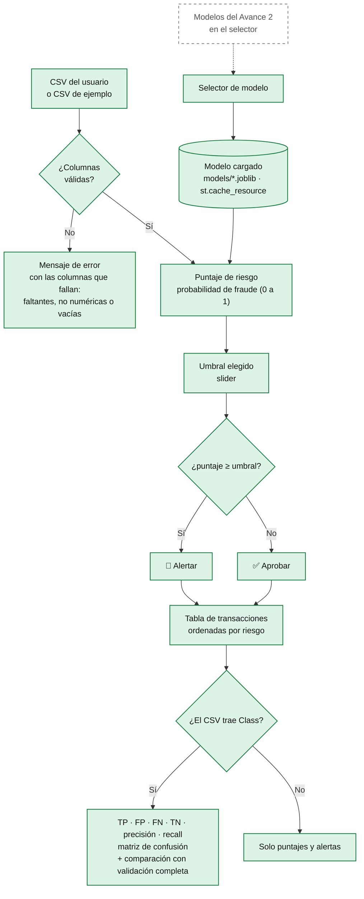

# Diagrama de flujo del sistema — Avance 1

El sistema tiene dos flujos:

1. **Entrenamiento (fuera de línea):** se ejecuta una vez, con `python -m src.entrenar_baseline`, y produce el modelo guardado.
2. **Uso (interfaz):** se ejecuta cada vez que alguien carga un CSV en la app de Streamlit. Usa el modelo guardado y no reentrena nada.

**Leyenda:**

| Estilo | Significado |
|---|---|
| Relleno verde, borde continuo | Implementado y funcionando (Avance 1) |
| Borde punteado gris | Planificado para el Avance 2 |
| Relleno rojo | Conjunto de prueba: reservado, no se usa hasta la evaluación final |

---

## 1. Flujo de entrenamiento (fuera de línea)



### Explicación de cada bloque

| Bloque | Qué hace | Por qué (lo que hay que poder defender) | Dónde está |
|---|---|---|---|
| **creditcard.csv** | Dataset de Kaggle (ULB): 284.807 transacciones, 492 fraudes (0,173 %). | Datos reales y anonimizados (V1–V28 son componentes PCA). Licencia ODbL. | `data/`, descargado con `src/descargar_datos.py` |
| **Eliminar duplicados** | Quita 1.081 filas idénticas (1.062 legítimas y 19 fraudes). Quedan 283.726 filas y 473 fraudes (0,167 %). | Si una copia queda en entrenamiento y otra en validación o prueba, el modelo se evalúa con datos que ya vio (fuga de información) y las métricas salen infladas. Por eso se hace **antes** de partir. | `src/datos.py` → `cargar_datos()` |
| **Partición estratificada 70/15/15** | Divide en entrenamiento, validación y prueba en dos pasos (0,30 y luego 0,50), con `stratify=y` y semilla 42. | La estratificación mantiene ≈ 0,167 % de fraudes en los tres conjuntos. Sin ella, con tan pocos fraudes, un conjunto podría quedar con muchos menos. La semilla hace que la partición sea reproducible. | `src/datos.py` → `particionar()` |
| **Entrenamiento (70 %)** | Datos con los que el modelo aprende. | Es lo único que ve `fit()`, incluido el escalador. | — |
| **Validación (15 %)** | Datos para comparar modelos y elegir hiperparámetros y umbral. | Permite tomar decisiones sin tocar la prueba. | — |
| **Prueba (15 %) 🔒** | Se separa, pero **no se usa** todavía. | Se usa una sola vez al final. Si decidiéramos mirándola, la métrica final sería optimista. | — |
| **Pipeline: StandardScaler + modelo** | Escala las variables (media 0, desviación 1) y luego entrena la regresión logística. | El escalador va **dentro** del pipeline para que su media y desviación salgan solo de entrenamiento. `Amount` y `Time` están en escalas muy distintas a V1–V28. Baseline: `solver=lbfgs`, `C=1,0`, `max_iter=1000`, sin manejo del desbalance. | `src/modelos.py` → `crear_logistica_sin_balanceo()` |
| **Avance 2 (punteado)** | Variantes del pipeline que se compararán con el baseline. | `class_weight` penaliza más los errores en fraude. **SMOTE** crea fraudes sintéticos **solo en entrenamiento**, dentro de un `imblearn.Pipeline`, para que nunca toque validación ni prueba. **Random Forest** captura relaciones no lineales. **Isolation Forest** detecta anomalías sin usar etiquetas. | `src/modelos.py` (por hacer) |
| **Evaluación en validación** | Calcula AUPRC (métrica principal), precisión, recall y matriz de confusión, y compara con el Dummy «nunca fraude». | La accuracy engaña: el Dummy acierta 99,83 % sin detectar ningún fraude. La AUPRC mide qué tan bien el puntaje ordena los fraudes arriba. Su referencia aleatoria es la proporción de fraudes (≈ 0,0017). Baseline actual: AUPRC 0,688. | `src/evaluacion.py` → `evaluar()`, notebook 02 |
| **models/*.joblib + *.json** | Guarda el pipeline entrenado, sus metadatos (columnas esperadas, fecha, hiperparámetros, métricas, tabla de umbrales) y los puntajes de validación. | La interfaz carga este archivo y no necesita reentrenar ni cargar el dataset completo. El `.json` permite revisar los metadatos sin Python. | `src/entrenar_baseline.py` |
| **Evaluación final (punteado)** | Evalúa el modelo elegido sobre la prueba, una vez. | Es la cifra que irá al informe final. | Entrega final |

---

## 2. Flujo de uso (interfaz Streamlit)



### Explicación de cada bloque

| Bloque | Qué hace | Por qué (lo que hay que poder defender) |
|---|---|---|
| **CSV del usuario o de ejemplo** | Se sube un CSV o se usa `data/ejemplo_transacciones.csv`: 2.000 filas de **validación** con sus 71 fraudes. | El ejemplo sale de validación y no de prueba, porque la prueba está reservada. Tiene ~20 veces más fraudes que la realidad, así que la precisión de la demo es optimista. Las cifras realistas están en *Resultados del modelo*. |
| **Validación de columnas (¿Columnas válidas?)** | Revisa que estén las 30 columnas que espera el modelo (leídas de los metadatos), que sean numéricas y sin vacíos, y que `Class`, si viene, solo tenga 0 o 1. | Sin esto, un CSV mal formado haría fallar el modelo con un error técnico incomprensible. Así el usuario ve qué columna falla. |
| **Mensaje de error** | Lista las columnas faltantes o con problemas. | Retroalimentación clara al usuario. |
| **Selector de modelo** | Lista solo los modelos cuyo `.joblib` existe en `models/`. | Hoy hay uno (el baseline). En el Avance 2 basta agregar una línea al diccionario `MODELOS` de `app/app.py`. |
| **Modelo cargado (`st.cache_resource`)** | Lee el `.joblib` una sola vez. | Streamlit vuelve a ejecutar todo el script en cada interacción. Sin caché, cada movimiento del slider volvería a leer el modelo del disco. |
| **Puntaje de riesgo** | `predict_proba(X)[:, 1]`: probabilidad estimada de fraude. El pipeline escala internamente con la media y desviación de entrenamiento. | El sistema no responde solo "sí o no": entrega un puntaje continuo que permite ordenar y elegir el umbral. Se guarda en caché (`st.cache_data`). |
| **Umbral (slider)** | El usuario elige desde qué puntaje se alerta. | Es la decisión de negocio. Bajarlo detecta más fraudes (menos FN, menos dinero perdido) pero genera más falsas alarmas (más FP, clientes bloqueados). |
| **¿puntaje ≥ umbral? → Alertar / Aprobar** | Convierte el puntaje en una acción. | Es el *actuador* del agente (PEAS): percibe la transacción y actúa aprobando o alertando. |
| **Tabla ordenada por riesgo** | Muestra las transacciones de mayor a menor puntaje, con su decisión. | Un analista revisaría primero las más sospechosas. |
| **¿Trae Class? → métricas** | Si el CSV trae la etiqueta real, calcula TP, FP, FN, TN, precisión, recall y la matriz, y las compara con la validación completa para el mismo umbral. Si no, solo muestra puntajes y alertas. | En un caso real no se conoce la etiqueta al momento de decidir. Las métricas sirven solo para evaluar con datos etiquetados. La comparación muestra que el recall coincide, pero los FP del ejemplo están subestimados. |

---

## 3. Cómo exportar a PNG (para el informe y las láminas)

**Opción A: mermaid.live (la más simple, sin instalar nada)**
1. Ir a <https://mermaid.live>.
2. Borrar el ejemplo del panel izquierdo (*Code*) y pegar **solo el contenido** de uno de los bloques de arriba: desde `flowchart TD` hasta la última línea de `classDef`/`style`, sin las líneas ` ```mermaid ` ni ` ``` `.
3. Revisar la vista previa a la derecha.
4. Exportar con **Actions → PNG** (o *SVG*, que se ve nítido a cualquier tamaño y Word/PowerPoint lo aceptan). Para el PNG conviene un ancho de al menos 1600 px para que se vea bien impreso.
5. Guardarlo en `docs/capturas/` (por ejemplo `diagrama_entrenamiento.png` y `diagrama_uso.png`).
6. Repetir con el otro diagrama.

**Opción B: dentro del editor**
- **GitHub** muestra los bloques Mermaid de este archivo como diagramas, sin hacer nada.
- **VS Code:** con la extensión *Markdown Preview Mermaid Support* se ve en la vista previa de Markdown (Ctrl+Shift+V).

**Consejos para las láminas:** el diagrama de entrenamiento es alto. En una lámina 16:9 se lee mejor si se cambia
`flowchart TD` (de arriba a abajo) por `flowchart LR` (de izquierda a derecha) antes de exportar.
